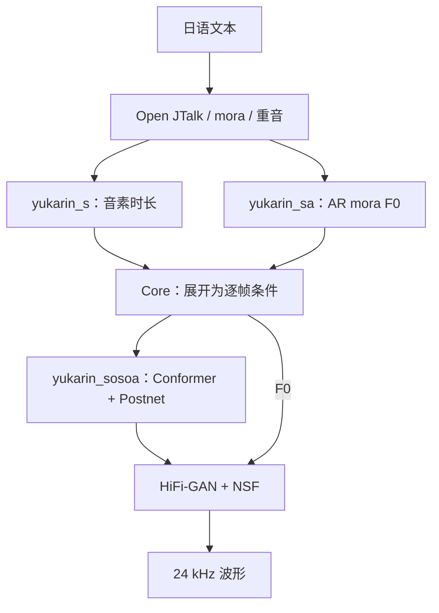

# VOICEVOX 新音色训练：源码分析与实施总结

整理日期：2026-10-17。目标是训练一个新的日语说话音色，尽量沿用作者公开网络，以独立 VVM 接入 VOICEVOX Core 0.17.0 的普通 `talk` 接口。本文依据此前源码调查及本项目实现整理；它不代表官方训练配方，也不意味着已复原正式产品模型。

## 1. 架构结论

“声学模型 + 神经声码器”的拆分成立，但完整文本到语音链路还包含日语前端、时长预测和音高预测。不能将作者公开实现整体归类为完全非自回归 FastSpeech2。

| 模块 | 作者公开实现 | 监督与主要输入 | 输出 |
| --- | --- | --- | --- |
| 日语前端 | Open JTalk + full-context parser | 日语文本、词典、经审查的读音/重音 | 音素、mora、四种重音/短语标记 |
| 时长 | `yukarin_s`：embedding + CNN | 音素 ID、speaker ID；音素真实持续时间 | 每音素秒数 |
| 音高 | `yukarin_sa`：编码器 + AR GRU | mora 母音/辅音、四种标记、speaker ID；真实 F0 | 每 mora 的 log-F0 |
| 声学 | `yukarin_sosoa`：Conformer + Postnet | 按时长展开的 F0/phoneme、speaker ID；真实频谱 | 帧级 spec |
| 声码器 | 作者 `hifi-gan` fork，可启用 NSF | spec + F0；真实波形 | 24 kHz 波形 |

需要纠正的常见推断：

- 音高导出包装器将上一拍预测 F0 反馈给下一拍，因此存在输出自回归；AR 粒度是 mora，不是音频采样点。
- 本路线源码明确使用作者 HiFi-GAN fork；没有依据把它写成 Parallel WaveGAN。
- Speaker embedding 维数由配置决定，不固定为 256。外部 style ID、内部 voice ID 和 speaker UUID 是不同概念。
- 普通 talk 没有单独 energy predictor；训练使用 volume 进行加权，不等于推理中预测能量。
- 样例 ONNX 的小文件大小不能外推到全部正式模型。CPU RTF < 0.1 尚未实测。
- ONNX 是推理格式，不能仅凭格式判断网络结构、质量、量化方式或实时性能。

## 2. “添加音色”的实际含义

首版选择生成独立模型和 VVM，与既有 VVM 共存。不会向已有产品权重追加一个随机 embedding 后宣称获得新声音。

支持两条初始化路线：

1. `scratch`：随机初始化作者网络。它适合完整研究训练过程，不保证少量录音即可获得自然音色。
2. `finetune`：使用本地已有且来源明确、配置和 profile 匹配的 PyTorch checkpoint。首版要求 speaker 表形状和映射一致，适用于单说话人基座的适配；新增 embedding 行、保留旧声线及防遗忘是另一项研究工作。

当前没有确认可公开下载且能直接用于目标音色的高质量四模块基座。作者演示权重并非正式产品品质。产品 VVM/ONNX 是推理产物，不应登记成可训练基座。完整恢复训练的 `resume` 与仅加载 predictor/generator 初始化也不能混用。

基座登记和校验细节见 [BASE_MODELS.md](../BASE_MODELS.md)。个人研究用途也应保留上游源码许可证及录音来源记录；本仓库没有随附产品权重或角色授权。

## 3. 如何准备日语训练语料

人工准备的核心是准确、稳定、可追溯的录音与文本，不需要手工逐帧绘制 F0。

- 建议保留 48 kHz / 24 bit / mono 原始 WAV；框架另生成 24 kHz 训练副本。保持设备、距离、增益和说话风格稳定，避免削波、背景人声和混响。
- 每条录音对应一句或自然短句，文本必须与实际发声一致。数字、专名、长音、无声化、促音和拨音需重点检查。
- 不做逐句最大值归一化、相对 dB Mel 或强降噪来掩盖采集问题。原始录音不可被派生流程覆盖。
- 使用 `manifest.jsonl`，记录 `utterance_id`、相对音频路径、原文/规范文本、可选人工读音、speaker/style、语言 `ja` 和录制会话。
- 固定 `train/valid/test`；相同音频、相同文本和同一源录音切片避免跨集合。最后 test 不进入四模块训练数据视图。
- ROHAN ENDSVILLE400 可作为首批文本覆盖与链路检查起点，不是官方最低句数或品质保证。公开文本许可不等于任意朗读音频都可使用。

前端自动生成 full-context labels 和四种 accent 标记，仍需抽查。外部强制对齐工具必须输出与前端逐项一致的音素序列；标签使用 `start end phoneme` 秒制三列，并从零连续到录音末端。HTK 100 ns 标签需显式指定单位转换。框架目前提供导入和验证，没有内置一键日语强制对齐器。

框架特征约定：

| 项目 | 本项目约定 |
| --- | --- |
| 音频/帧频 | 24,000 Hz、hop 256、93.75 frames/s |
| 音素表 | 作者/Core 顺序的 45 音素，不按语料重排 |
| F0 | 有声为自然对数 Hz、无声为 0；保留实测 Hz 以便诊断 |
| spec | 作者 HiFi-GAN 的幅度 Mel → 自然对数压缩 |
| 起步频谱配置 | FFT/win 1024、80 Mel、fmin 0、fmax 12000；这是研究配置，不是正式产品参数推断 |
| 中间文件 | NPZ `array + rate`，读取禁用 pickle；给作者 loader 的受控 NPY dict 由 materialize 生成 |

完整字段、目录与 speaker 映射例子见 [DATA_FORMAT.md](../DATA_FORMAT.md)。

## 4. VVM 兼容目标

目标是 Core 0.17.0 / VVM format 2 / talk。三个推理入口为：

| ONNX | 输入 | 输出 |
| --- | --- | --- |
| `predict_duration` | `phoneme_list` int64 `[N]`、`speaker_id` int64 `[1]` | `phoneme_length` float32 `[N]` |
| `predict_intonation` | 标量 `length`、母音/辅音与四种标记 int64 `[M]`、speaker ID | `f0_list` float32 `[M]` |
| `decode` | `f0` float32 `[T,1]`、`phoneme` float32 `[T,45]`、speaker ID | `wave` float32 `[T*256]` |

作者 acoustic 和 vocoder wrapper 在本框架中串联成只输出 wave 的 decode。不能直接把返回 `(spec, wave)` 的辅助模型装进普通 talk；也不能把接受 spec+F0 的作者 vocoder 直接登记为只接受 spec 的 streaming 接口。

打包检查独立 model/speaker UUID、公开 style ID 冲突和 public→inner 映射。静态 ZIP/ONNX 合格、Core 能加载、服务能合成、音色听感达标是四种不同验收。NSF 带随机激励时，不宣称 decode 波形逐样本一致；仍检查动态长度、有限值，时长与音高继续进行数值比对。

## 5. 已实现与仍需完成的工作

已实现：语料校验、无损保留原件的重采样、作者标签解析、外部对齐导入、F0/频谱提取、原生数据视图和配置、调用真实上游训练器、checkpoint 整理、原生合成、ONNX 导出及 Runtime 验证、VVM 打包、指定 Core/本地服务隔离验证。

此前开发验证包括：三个模块在合成音调上完成 CPU 短训练；四模块原生 dataset 加载；微型随机作者网络的 ONNX 导出和完整 Forwarder 推理；synthetic ONNX 在本地 Core 0.17.0 / Runtime 1.17.3 与现有服务上的加载合成。这些是链路证据，不是目标音色、收敛或品质证据。测试代码随仓库提交，运行日志、测试权重和 WAV 不提交。

仍需真实目标录音、经检查的对齐/重音、NVIDIA CUDA 声码器训练，以及保留集上的发音、自然度、相似度和重建质量评估。当前 pip pyopenjtalk 与锁定 VOICEVOX fork 未被证明完全一致，工具会记录实际版本；正式复现还应核对字典和前端行为。

## 6. 相似项目的定位

ESPnet2 FastSpeech2 + HiFi-GAN/PWG 有完整公共 recipe，适合学习日语 TTS 训练，但 token、G2P、帧率和模型入口与 VVM 不同，不能通过改后缀获得兼容性。SBV2 更偏向另一路独立模型训练与服务接入；NNSVS 主要面向歌唱，包含音符/乐谱标签；nnmnkwii 适合学习传统参数化声学建模。选择作者四模块路线，是为了保留当前 Core talk 契约和模块实现。

## 7. 可复核的一手来源

源码版本与补丁完整记录见 [upstream.lock.json](../upstream.lock.json)。关键出处：

- [作者公开推理工程及演示权重说明](https://github.com/Hiroshiba/vv_core_inference/tree/df60099ccd58a54352bf0239b60cb29794385473)
- [时长 CNN](https://github.com/Hiroshiba/yukarin_s/blob/50556896d74acd6252b84dc16e58af8cb15cc7d0/yukarin_s/network/predictor.py)
- [音高自回归导出包装器](https://github.com/Hiroshiba/vv_core_inference/blob/df60099ccd58a54352bf0239b60cb29794385473/vv_core_inference/make_yukarin_sa_forwarder.py)
- [声学 Conformer/Postnet](https://github.com/Hiroshiba/yukarin_sosoa/blob/22aa731d56bb5f1c9fe4bfab12b661035cb4a0e2/yukarin_sosoa/network/predictor.py)
- [HiFi-GAN/NSF Generator](https://github.com/Hiroshiba/hifi-gan/blob/265da0f0f71923336615d6657f195ffdc6df25e4/hifi_gan/models.py)
- [Core 0.17.0 talk 契约](https://github.com/VOICEVOX/voicevox_core/blob/0.17.0/crates/voicevox_core/src/core/infer/domains/talk.rs)
- [ROHAN 日语朗读文本](https://github.com/mmorise/rohan4600)

运行顺序见 [RUNBOOK.md](../RUNBOOK.md)，导出与 Core 检查细节见 [EXPORT.md](EXPORT.md)。
